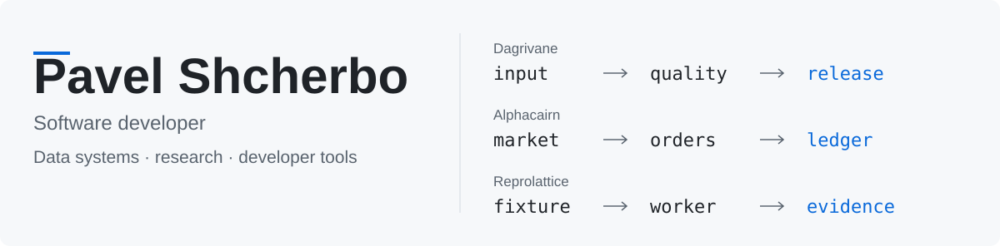
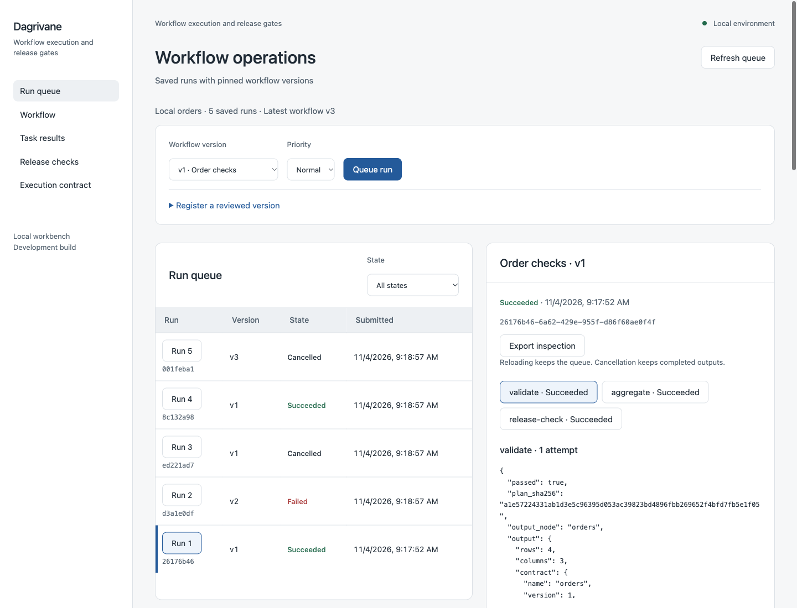
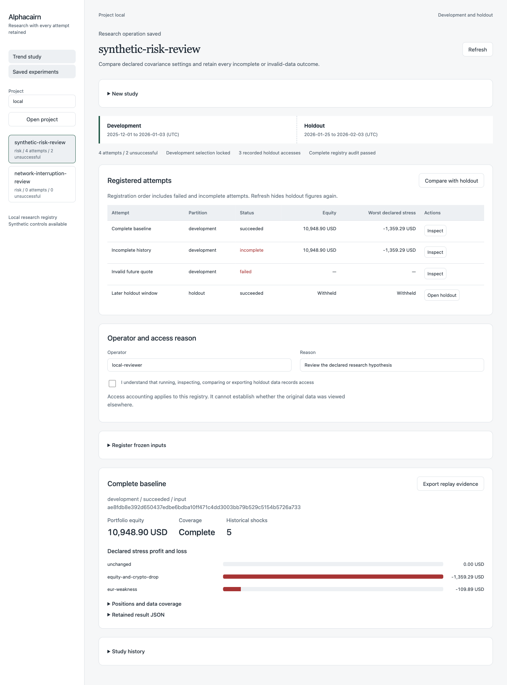
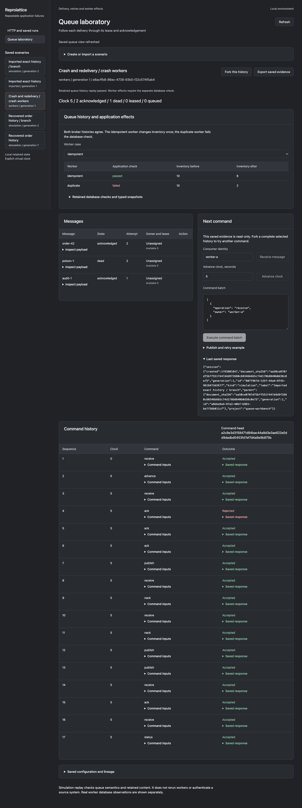

<picture>
  <source media="(prefers-color-scheme: dark) and (max-width: 600px)" srcset="assets/profile-dark-mobile.svg">
  <source media="(max-width: 600px)" srcset="assets/profile-light-mobile.svg">
  <source media="(prefers-color-scheme: dark)" srcset="assets/profile-dark-desktop.svg">
  
</picture>

I’m a software developer from Belarus, available for full-stack projects. I work with Python and JavaScript, from web applications and APIs to tools for data processing and reproducible testing.

Try the current preview: [Reprolattice v0.2.0](https://github.com/Pavel-Shcherbo/reprolattice/releases/tag/v0.2.0) — [reproduce a retry failure](https://github.com/Pavel-Shcherbo/reprolattice/blob/main/docs/START_HERE.md).

[LinkedIn](https://www.linkedin.com/in/pavel-shcherbo-8b7b901a9/) · [Selected work](#selected-work) · [Technical focus](#technical-focus) · [More projects](#more-projects)

## Selected work

### [Dagrivane](https://github.com/Pavel-Shcherbo/dagrivane)

**Data pipelines and release workflows.** Run typed data transformations, enforce quality gates and trace a release back to its inputs. Retained checkpoints, worker leases and timezone-aware schedules make interruption and recovery explicit.

[Source & quick start](https://github.com/Pavel-Shcherbo/dagrivane#readme) · [Architecture](https://github.com/Pavel-Shcherbo/dagrivane/blob/main/docs/ARCHITECTURE.md) · [Verification](https://github.com/Pavel-Shcherbo/dagrivane/blob/main/docs/VERIFICATION.md)

Preview and engineering details

- Typed CSV processing, bounded joins, explicit decimal arithmetic and quality checks.
- Incremental HTTP ingestion with raw-page retention, cursor recovery and reviewed schema changes.
- Content-addressed artifacts, lineage, immutable releases and replayable schedule evidence.

The workbench executes trusted local commands. Workspace scoping is not hosted user authentication or an operating-system sandbox.

### [Alphacairn](https://github.com/Pavel-Shcherbo/alphacairn)

**Reproducible stock and crypto research.** Keep decision-time data separate from realized prices, simulate orders under explicit assumptions and reconcile the result through an exact portfolio journal.

[Source & quick start](https://github.com/Pavel-Shcherbo/alphacairn#readme) · [Architecture](https://github.com/Pavel-Shcherbo/alphacairn/blob/main/docs/ARCHITECTURE.md) · [Verification](https://github.com/Pavel-Shcherbo/alphacairn/blob/main/docs/VERIFICATION.md)

Preview and engineering details

- Historical data revisions and universe membership at each decision time.
- FIFO holdings, fees, FX, splits, dividends and calendar-based cash settlement.
- Multi-asset risk and stress scenarios, retained failed attempts and portable offline replay.

Examples use synthetic data. This is a research tool, not a live brokerage connection or a claim of investment performance.

### [Reprolattice](https://github.com/Pavel-Shcherbo/reprolattice)

**Reproduce failures across HTTP, SQLite and queues.** Run real clients and workers against controlled dependencies, inspect their effects and retain a scenario that someone else can replay.

[Source & quick start](https://github.com/Pavel-Shcherbo/reprolattice#readme) · [Architecture](https://github.com/Pavel-Shcherbo/reprolattice/blob/main/docs/ARCHITECTURE.md) · [Verification](https://github.com/Pavel-Shcherbo/reprolattice/blob/main/docs/VERIFICATION.md)

Preview and engineering details

- Ordered HTTP fixtures, typed assertions, isolated scenario suites and JSON/HTML/JUnit reports.
- Before/after SQLite evidence and reversible migration rehearsals with retained failure states.
- Queue redelivery, visibility timeouts, delivery tokens and crash-worker side-effect checks.

A correct acknowledgement is checked separately from a correct database effect. The local application harness is not an operating-system sandbox or a production message broker.

How this work is verified

The current suites contain **880 unit and integration tests**, passed on CPython 3.14.6 on macOS arm64. The earlier 871-test baseline was exercised on CPython 3.10–3.14, with clean installed CLI/API scenarios on 3.10 and 3.14. Each repository distinguishes current increment checks from that earlier qualification and links its control inputs, resource limits and retained verification records.

Earlier timestamps in these three repositories are explicitly disclosed reconstructed development stages, assembled in November 2026. They do not establish original work in those years. Current implementation and proposed roadmap items are documented separately.

## Open-source contributions

- [Pillow #10434](https://github.com/python-pillow/Pillow/pull/10434) — **merged**: fixed `getcolors()` hanging with a negative color limit. The maintainer revised the original proposal into a Python guard; the merged change includes a regression test.
- [responses #845](https://github.com/getsentry/responses/pull/845): a composable pytest-fixture recipe with four tested scenarios and a separately executed README example. Focused checks and pinned hooks pass; upstream review and CI approval remain pending.
- [redis-py #4577](https://github.com/redis/redis-py/pull/4577): proposed next-major support for four typed Redis Cluster URL options across sync and async clients. Includes 156 new cases; 225 focused checks pass on Python 3.12 and 3.14. Maintainer acceptance and full integration CI remain pending.
- [Dagster #34402](https://github.com/dagster-io/dagster/pull/34402): code and regression tests for Kubernetes pod logs whose timestamps use different fractional-second precision. The follow-up correction preserves split message fragments such as `v1.2.0Z`. All 45 focused Pipes unit tests pass locally; upstream review and CI remain visible in the PR.
- [Dagster #34389](https://github.com/dagster-io/dagster/pull/34389#issuecomment-6647988236): supplied a failing-before/passing-after regression for an HTTP 500 followed by a connection error. The author added the test to the PR.

### Reviews

- [responses #842](https://github.com/getsentry/responses/pull/842#discussion_r4474910164): reproduced a nested-JSON comparison regression against the exact base and PR head, including a real RequestsMock call. All 81 matcher tests passed; the review adds a runnable compatibility control.
- [RESPX #337](https://github.com/lundberg/respx/pull/337#issuecomment-6662125950): checked cookie expiration across timezone offsets and DST boundaries. The author retained the suggested public HTTPX cookie-jar regression; six focused checks pass on the updated head, and the new regression fails with the original implementation.

Validation applies to the linked revisions: the responses review used CPython 3.14.6; the latest RESPX follow-up used CPython 3.12.9. Full compatibility matrices and maintainer decisions are separate from these focused checks.

### Community answers

- [Positron #17167](https://github.com/posit-dev/positron/discussions/17167#discussioncomment-19431617): traced the Python-installation picker to the external uv version catalog. The author confirmed that upgrading uv resolved the problem and marked the answer as accepted.

## Technical focus

| Area | Technologies |
| --- | --- |
| Backend & data | Python, Django, Node.js / Express, PostgreSQL, SQLite |
| Web interfaces | JavaScript, HTML, CSS; also TypeScript and Next.js |
| Mobile | Android, Firebase Auth |
| Systems & tooling | Git, Linux, HTTP/JSON, WireGuard / IPsec |

I’ve also worked with Java and C. I prefer explicit assumptions, useful failure reports and examples that another developer can run.

## More projects

- [adaptive-vpn](https://github.com/Pavel-Shcherbo/adaptive-vpn) — switches between WireGuard and IPsec using ping, jitter and bandwidth measurements.
- [process_manager](https://github.com/Pavel-Shcherbo/process_manager) — business processes and document management with roles, a process tree and analytics. Django and PostgreSQL.
- [activity-planner](https://github.com/Pavel-Shcherbo/activity-planner) — weekly planning with conflict checks and a REST API. Node.js and Express.
- [FreelanceHub](https://github.com/Pavel-Shcherbo/FreelanceHub) — an Android marketplace prototype with Firebase sign-up/sign-in, requirements and diagrams.

## Work together

Available for full-stack development, backend/API work and developer tooling. Reach me on [LinkedIn](https://www.linkedin.com/in/pavel-shcherbo-8b7b901a9/).
